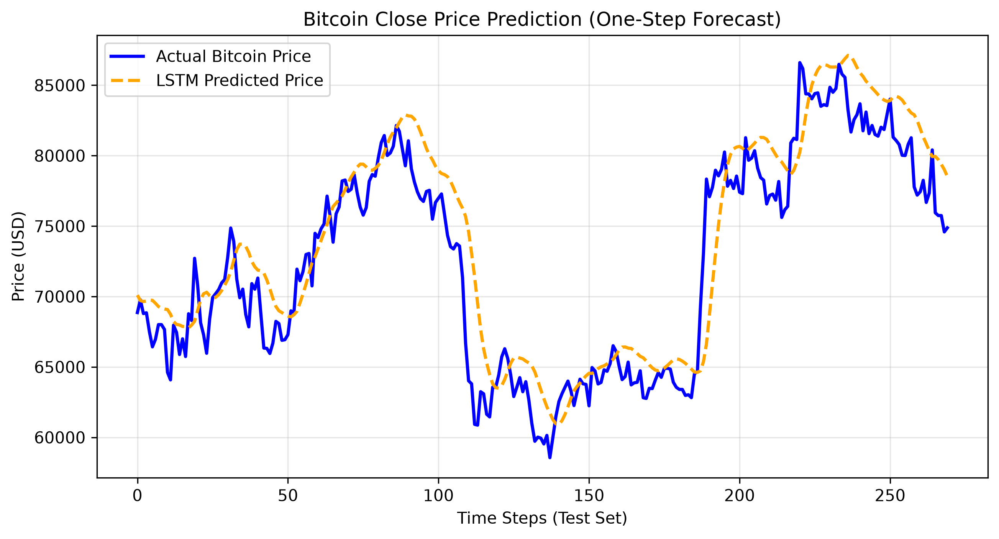
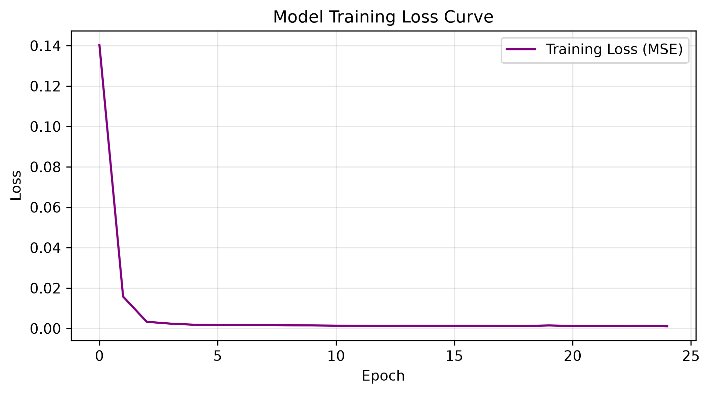

# Bitcoin LSTM Time Series Forecasting

A PyTorch-based implementation of a Long Short-Term Memory (LSTM) recurrent neural network designed for univariate **one-step-ahead closing price prediction** of Bitcoin.

---

## 📈 Model Performance & Visuals

### 1. Actual vs. Predicted Bitcoin Prices
The chart below illustrates the model's capability to track market trends and predict next-day closing prices on out-of-sample test data:


### 2. Training Convergence
The optimization trajectory tracked via Mean Squared Error (MSE) loss across training epochs:


---

## 🚀 Quick Start

1. **Install dependencies:**
   ```bash
   pip install -r requirements.txt